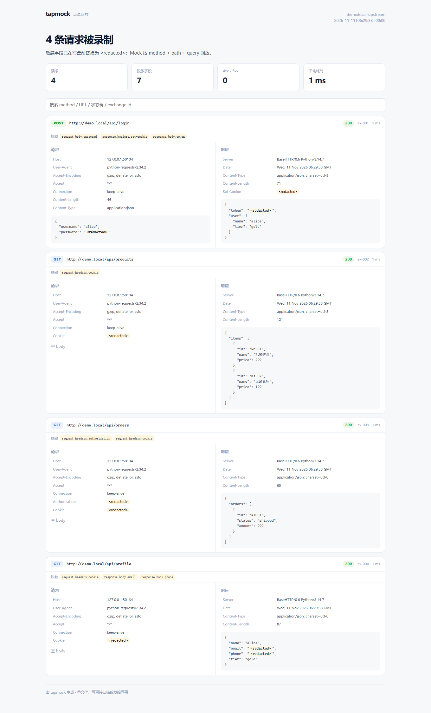

# tapmock

[](https://github.com/natorshzhong-netizen/tapmock/actions/workflows/ci.yml)

**录一次 HTTP(S) 流量，脱敏后变成可离线回放的 Mock 服务。**

前端等不到后端？线上问题本地复现不了？用真实流量录一份 tape，之后不连后端也能跑；接口改了，再用 replay 逐字段比对差异。



## 它解决什么问题

- **联调阻塞**：后端没就绪时，前端对着录好的 Mock 开发，字段和状态码都是真的。
- **问题复现**：把线上/测试环境的一次请求录下来，本地反复回放，不依赖环境。
- **回归检查**：接口改动后，把 tape 重放到新服务，逐字段指出新增、删除、变化的 JSON 路径。

> 它不是压测工具，也不是安全测试工具；重点是把「一次真实请求」变成可保存、可脱敏、可回放的资产。

## 快速开始

```bash
python -m venv .venv

# Windows
.venv/Scripts/python.exe -m pip install -r requirements.txt
.venv/Scripts/python.exe -m src.tapmock demo --open

# macOS / Linux
.venv/bin/python -m pip install -r requirements.txt
.venv/bin/python -m src.tapmock demo --open
```

`demo` 会启动一个本地上游 API，用 mitmproxy 反向代理录 4 条真实请求，脱敏后写入 `demo/tape.json`，再启动 Mock 回放并打开流量视图。全程不需要浏览器配置代理。

Windows 也可以直接双击 `start.bat`。

## 四种用法

### 1. 录制：反向代理（推荐，无需装证书）

```bash
python -m src.tapmock record \
  --target http://127.0.0.1:9000 \
  --port 8081 \
  --out tape.json \
  --view reports/tape.html
```

把请求发到 `http://127.0.0.1:8081`，mitmproxy 转发到 `--target` 并录制。

### 2. 录制：正向代理（浏览器 / 手机）

```bash
python -m src.tapmock record --forward --port 8081 --out tape.json
```

把浏览器或手机代理设为 `127.0.0.1:8081`。抓 HTTPS 需要访问 <http://mitm.it> 安装 mitmproxy 证书。

### 3. Mock

```bash
python -m src.tapmock mock --tape tape.json --port 8080 --cors
```

按 `method + path + query` 匹配；同一路径录了多次时，按录制顺序依次返回。未命中返回 404，并记录在服务的 `unmatched` 列表里。

### 4. 回放与差异

```bash
python -m src.tapmock replay --tape tape.json --target http://127.0.0.1:9000 --fail-on-diff
```

JSON 响应逐字段比较，输出类似：

```text
✗ ex-003 GET /api/orders
    changed      $.orders[0].status: "shipped" → "pending"
```

`--header Authorization=Bearer ...` 可以覆盖录制时被脱敏的认证头。

### 5. 看 tape

```bash
python -m src.tapmock view --tape tape.json --out reports/tape.html --open
```

## 脱敏规则

写盘前替换，tape 里不会出现原始明文：

| 位置 | 规则 |
|---|---|
| 请求/响应头 | `Authorization`、`Cookie`、`Set-Cookie`、`X-Api-Key`、`X-Auth-Token` 等 |
| URL query | 参数名包含 `token` / `secret` / `password` / `api_key` / `email` / `phone` 等 |
| JSON body | 递归替换敏感 key 的值，保留字段名和数组长度 |
| form body | 同 query 规则 |
| 额外字段 | `--redact field1,field2` |

值统一替换为 `<redacted>`。Mock 匹配不看 body，所以脱敏不影响回放。

## 评测

```bash
python eval/run_eval.py
```

| 指标 | 结果 |
|---|---|
| 脱敏泄漏（20 条请求 × 5 类字段） | 0 |
| Mock 命中 | 20 / 20 |
| 未命中返回 404 | ✓ |
| 回放检出变化 | 5 / 5 |
| 回放误报 | 0 |
| 端到端录放 | 4 条录制 / 4 条回放 |
| 测试 | 16 passed |

> 数字来自仓库自带的合成 tape 和本地上游，不是公开数据集；用于回归，不代表对任意生产流量的覆盖率。

## 架构

```text
客户端 ──► mitmproxy（反向/正向）──► 上游
                │ response hook
                ▼
         redact.py：头 / query / JSON / form
                │
                ▼
            tape.json
          ┌─────┼─────────────┐
          ▼     ▼             ▼
       mock.py  replay.py   view.py
       Mock 服务 逐字段 diff   HTML 视图
```

## 关键设计决策

### 1. 脱敏发生在写盘之前

不是录完再清洗，而是 response hook 里先替换再落盘。这样即使录制进程被 Ctrl+C、tape 被误提交，也不会留下明文 token。每条请求的 `redactions` 字段会记录替换了哪些位置，方便审计。

### 2. 保留字段名，只替换值

如果把整个 body 清空，Mock 返回的结构就失真了；所以 JSON 只替换敏感 key 的 value，字段名、数组长度、嵌套结构都不动。前端拿到的响应形状和真实一致，mock 才可信。

### 3. 匹配忽略 host，只看 method + path + query

录制时的 host 可能是 `127.0.0.1:随机端口` 或测试域名，Mock 却在另一个端口启动。匹配 host 会让 tape 不可移植，所以只看路径和 query；query 参数顺序不影响匹配。

### 4. 回放比较 JSON 结构，不比较整段文本

字符串比较只会告诉你「不一样」，逐字段 diff 才能告诉你「`$.orders[0].status` 从 shipped 变成了 pending」。数组长度、新增/删除 key、类型变化分别标记，最多展示 20 条，避免刷屏。

### 5. 默认反向代理，降低使用门槛

HTTPS 正向代理需要客户端装 CA 证书，第一次用很容易卡住。`demo` 和 `record --target` 走反向代理，客户端只需要改端口，不碰证书；只有抓真实浏览器/App 流量时才需要 `--forward`。

## 目录

```text
tapmock/
├── demo/tape.json        # 演示 tape（已脱敏）
├── docs/tape.png         # 流量视图截图
├── src/tapmock/
│   ├── redact.py         # 脱敏规则
│   ├── tape.py           # tape 读写与匹配索引
│   ├── addon.py          # mitmproxy response hook
│   ├── recorder.py       # mitmdump 进程管理
│   ├── mock.py           # Mock HTTP 服务
│   ├── replay.py         # 回放与 JSON diff
│   ├── view.py           # 单文件 HTML 视图
│   ├── demo.py           # 端到端演示
│   └── cli.py            # demo / record / mock / replay / view
├── eval/                 # 脱敏 + Mock + 回放 + 录放评测
├── tests/                # 16 个测试
└── .github/workflows/ci.yml
```

## 局限

- 正向代理抓 HTTPS 需要客户端安装 mitmproxy CA 证书；企业环境可能有证书固定（pinning），这种情况录不到。
- Mock 只按 `method + path + query` 匹配，不比较请求 body；同一路径不同 body 的场景靠录制顺序区分。
- 脱敏依赖字段名规则，自定义密钥需要用 `--redact` 补充；二进制 body 不扫描。
- 不处理 WebSocket、HTTP/2 多路复用的协议级细节，mitmproxy 解码成 HTTP 消息后才进入 tape。

## License

MIT © 2026 钟诚
